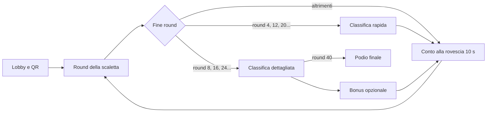

# PubGame — descrizione del gioco

> **VERSIONE BETA — snapshot del 7 novembre 2026.**
> Il documento fotografa il gioco **così com'è adesso**, prima del refactoring della
> prossima versione. Le modifiche in arrivo non sono ancora descritte qui: verranno
> annotate dopo. Se una regola non combacia col codice, vince il codice.

> Documento per chi arriva sul repository o deve spiegare PubGame a qualcun altro.
> Aggiornato al 7 novembre 2026 (beta).

---

## Decisioni definitive (la versione da seguire)

### Scaletta: 40 round in 5 atti da 8

| Atto | 1 | 2 | 3 | 4 | 5 | 6 | 7 | 8 |
|---|---|---|---|---|---|---|---|---|
| 1 | Quiz | Musica | Black Jack | Time Buzzer | Timeline | Air Hockey | Ultima spiaggia | Bomba |
| 2 | Azzardo | Ruota | Black Jack | Quiz | Air Hockey | Time Buzzer | Ultima spiaggia | Arena |
| 3 | Quiz | Musica | Speed Rush | Indovina chi | Air Hockey | Time Buzzer | Ultima spiaggia | Black Jack |
| 4 | Indovina chi | Bomba | Musica | Quiz | Ruota | Timeline | Ultima spiaggia | Speed Rush |
| 5 | Quiz | Musica | Bomba | Indovina chi | Azzardo | Timeline | Ultima spiaggia | Arena |

Vincoli: mai due giochi in tempo reale di fila (Bomba, Arena, Speed Rush, Air Hockey, Black Jack), mai due giochi a prenotazione consecutivi (Musica, Indovina chi, Ruota), Arena a chiudere gli atti 2 e 5. Classifica rapida ai round 4, 12, 20, 28, 36; dettagliata ai round 8, 16, 24, 32, 40.

### Quattro bonus, dopo gli atti 1-4 (non consumano round)

1. **Roulette** (dopo l'atto 1), due manche: ruota colorata e ruota numerata con puntate su fasce, pallina che rallenta e quasi si ferma sul numero vicino. Si punta con gettoni bonus, nessun punteggio negativo.
2. **Basket** (dopo l'atto 2), 3 manche sul telefono; la TV mostra solo i vincitori. Il premio cresce a scaletta (per esempio 100, 200, 400) in base alla vittoria e a quanto si stringe il cerchio.
3. **Cavallo di battaglia** (dopo l'atto 3), una sola volta. Ogni squadra sceglie la propria categoria preferita sul telefono e risponde a 8 domande difficili il più in fretta possibile. La TV mostra le squadre dalla peggiore alla migliore, con categoria e risposte giuste. Vince una consumazione per il tavolo chi risponde bene a più domande; punti proporzionali alle risposte giuste per chi partecipa (partecipare è facoltativo).
4. **Blackjack** (dopo l'atto 4), a turni: la TV è il banco (si ferma a 17, regola scritta sulla TV) e ogni squadra gioca contro di lui per circa 20 s con Carta o Stai dal telefono; gli altri tavoli fanno il tifo. Si punta 100, 200 o 300 gettoni; il blackjack paga 3:2. Premio: +150 punti a chi batte il banco, consumazione solo a chi fa blackjack naturale o vince con la mano più alta (da decidere con il locale).

### Round nuovi

- **Bomba** (3 volte). Round di 90 s. Bombe: 2 per 4-6 squadre, 3 per 7-10. Chi la tiene risponde a una domanda a tempo (5 s): se giusta la passa a uno di 3 tavoli casuali, altrimenti la bomba resta e la miccia perde 3 s. La miccia dura 20-30 s ed è nascosta (solo scintille e battiti più veloci). All'esplosione chi la tiene perde 300 punti e una nuova bomba parte da un altro tavolo. Ogni squadra parte da 1000 punti di round, +50 per passaggio fino a +500, mai sotto zero. La bomba non torna subito a chi l'ha passata. Domande Vero/Falso nell'atto 1, a 3 opzioni negli atti 4 e 5, difficili con miccia più corta nell'atto 5.
- **Ultima spiaggia** (5 volte, penultimo round di ogni atto). Cinque round; in ogni round si estrae una categoria. Ogni squadra sceglie un livello da 100 a 500 e lo consuma: ogni livello si usa una volta sola, quindi all'ultimo round ne resta uno. Ogni telefono riceve la domanda del proprio livello a quattro risposte, uguale per chi ha scelto lo stesso livello. Giusta = +livello, sbagliata o scaduta = −metà (100 → +100/−50, 500 → +500/−250). Chi non sceglie il livello entro 12 s prende il più basso rimasto.
- **Azzardo** (2 volte, atti 2 e 5). 4 domande con risposta numerica. Per ogni domanda la TV mostra 4 fasce con la quota (più stretta è la fascia, più è alta). Ogni squadra distribuisce 100 gettoni nuovi sulle fasce dal telefono; scorciatoie "Tutto su una", "50-50", "Spalma". La TV svela il valore: i gettoni sulla fascia giusta pagano la quota (tetto 500 per domanda), gli altri sono persi, nessun punteggio negativo. Senza puntata, 25 gettoni per fascia. Le quote dipendono dall'ampiezza e dalla plausibilità, non da dove cade il valore, e sono tarate circa il 10% sotto il giusto. La TV mostra dove ha puntato il pubblico e nomina "il cecchino". Serve una banca di circa 60 domande numeriche con valori verificati.

### Da fare prima di tutto

Ampliare la banca domande: almeno 800 Vero/Falso (Arena e Bomba) e domande a 3 opzioni per la Bomba, 12-15 domande difficili per categoria per il Cavallo, circa 60 domande numeriche per Azzardo, più Indovina chi (oggi solo 6). Per Ultima spiaggia bastano le fasce della banca QUIZ: 15+ domande per fascia e categoria coprono i cinque livelli.

## 1. Cos'è

PubGame è un **gioco a squadre da pub**: una serata di circa due ore divisa in tanti piccoli giochi, con una classifica che li lega tutti.

- Giocano **4-10 squadre**, ognuna al proprio tavolo e con **un telefono**.
- Una **TV** condivisa mostra il gioco, le classifiche e gli effetti.
- Un **presentatore** (l'admin) conduce la serata dal suo telefono: lancia i round, giudica le risposte a voce, avvia i bonus.

Non serve installare niente: i telefoni aprono una pagina web (PWA) inquadrando il QR code in TV.

### Cosa lo rende diverso da un quiz

- **Tanti tipi di gioco**, ognuno con un'emozione diversa: sapere, riconoscere, ordinare, rischiare, correre, sfidarsi.
- **Tutti i tavoli giocano insieme** nella maggior parte dei round: nessuno aspetta il proprio turno.
- **La TV è uno spettacolo**, non un tabellone: corsie, cerchi che si stringono, dischi, ruote, countdown con suspense.
- **Chi è indietro resta in partita**: bonus, giochi a eliminazione e punteggi per piazzamento tengono aperta la classifica.

---

## 2. Come si presenta in pratica

| Schermata | Dispositivo | Indirizzo | A cosa serve |
| --- | --- | --- | --- |
| **TV** | Computer collegato al televisore | `/tv` | Mostra QR, gioco, classifiche, demo e bonus |
| **Telefono squadra** | Smartphone | `/play` | Sceglie il nome, risponde, preme i pulsanti del gioco |
| **Admin** | Smartphone del presentatore | `/admin` | Controlla il flusso e giudica le risposte a voce |
| **Basket bonus** | Smartphone | `/basket?player=NOME` | Mini-gioco bonus a canvas |

**Una serata, passo per passo**

1. L'admin preme **APRI LOBBY**: la TV crea la partita e mostra il **QR code**.
2. Ogni tavolo inquadra il QR, apre `/play` e sceglie il **nome della squadra**.
3. L'admin preme **PROSSIMO ROUND**: la scaletta decide il gioco, la TV annuncia il tipo e parte.
4. A fine round i punti vanno in classifica. Dopo 10 secondi parte da solo il round successivo, a meno che l'admin non lo fermi (pausa, classifica, demo).
5. Ai round 4, 12, 20, 28, 36 compare la **classifica rapida**; ai round 8, 16, 24, 32, 40 la **classifica dettagliata**, con rullo e suspense sul podio.
6. Tra un atto e l'altro l'admin lancia il **bonus** previsto (vedi sezione 5).
7. Dopo il round 40 c'è il podio finale.



---

## 3. La scaletta: 40 round in 5 atti

La scaletta definitiva è la tabella in "Decisioni definitive". Nel codice (`round-manager.service.ts`) è già allineata: il Cavallo non è più in scaletta (è tornato bonus dopo l'atto 3), Ultima spiaggia è fissa al penultimo round di ogni atto (7, 15, 23, 31, 39) e Azzardo esce due volte (atti 2 e 5). Classifiche: rapida ai round 4, 12, 20, 28, 36; dettagliata ai round 8, 16, 24, 32, 40.

## 4. I giochi di round

Tre famiglie, in base a come rispondono i tavoli:

- **Tutti insieme sul telefono**: ogni squadra risponde per conto suo, nello stesso momento (Quiz, Timeline, Time Buzzer).
- **Prenotazione**: la prima squadra che preme risponde a voce e l'admin conferma o respinge (Musica, Indovina chi, Ruota).
- **Tempo reale**: i telefoni agiscono di continuo e la TV mostra una gara o uno scontro (Speed Rush, Air Hockey, Arena).

### Quiz — sapere
- **Come si gioca:** domanda a 4 risposte, 10 secondi per rispondere. Prima c'è una breve lettura e l'animazione della categoria (sono 16).
- **Punti:** +1000 × tempo rimasto se giusta, −1000 × tempo rimasto se sbagliata, 0 se non risponde. Chi risponde presto vale di più.

### Indovina chi — riconoscere
- **Come si gioca:** la TV mostra la foto di un personaggio, sfocata, che si schiarisce nei 30 secondi. Si prenota dal telefono e si risponde a voce.
- **Punti:** +1000 × tempo rimasto se giusta, −1000 × tempo rimasto se sbagliata. L'admin conferma. Se sbagli, il gioco riparte per gli altri.

### Musica — ascoltare
- **Come si gioca:** parte un brano in quattro manche. Si prenota e si indovina titolo e artista. L'audio si ferma alla prenotazione.
- **Punti:** +2000 / +1500 / +1000 / +500 a seconda della manche in cui si indovina; −1000 se sbagli.
- **Contenuti:** anteprime da 30 secondi (iTunes Search API) o brani scaricati in locale.

### Ruota della Fortuna — parola
- **Come si gioca:** la TV mostra una frase (proverbi e modi di dire) con le lettere nascoste. Ogni 10 secondi se ne scopre una, partendo dalle più rare, in ordine sempre uguale per la stessa frase. Chi prenota prova a dire la frase; l'admin giudica. Durata 75 secondi.
- **Punti:** +1000 × tempo rimasto se giusta, −1000 × tempo rimasto se sbagliata.

### Timeline — ordinare
- **Come si gioca:** sul telefono compaiono **6 carte** (a round alterni **8**) con eventi storici mescolati. Si toccano dalla più antica alla più recente. Gli anni non arrivano ai telefoni: la soluzione resta sul server e la TV la mostra al reveal. Durata 45 secondi, tutte le squadre insieme.
- **Punti:** fino a **+1200**: 1000 × frazione di coppie di carte nell'ordine giusto, più 200 se l'ordine è perfetto. Una consegna con zero coppie giuste non conta come corretta.
- **Contenuti:** 113 eventi con anno e categoria.

### Time Buzzer — sentire il tempo
- **Come si gioca:** la TV mostra un tempo bersaglio casuale tra 5 e 30 secondi. Ogni telefono ha **un solo pulsante verde**: START quando vuole, STOP quando pensa di essere arrivato al tempo, senza cronometro. Sono **3 manche**; a ogni manche esce circa un terzo delle squadre, cioè quelle più lontane dal bersaglio. Chi non preme è sempre ultimo e viene eliminato per primo.
- **Punti:** +300 / +200 / +100 / +50 secondo la vicinanza al bersaglio. Gli eliminati restano bloccati.

### Speed Rush — riflessi
- **Come si gioca:** ogni squadra ha una **corsia** sulla TV. Sul telefono arrivano microprove da pochi secondi: tocchi ripetuti, intruso, ordina numeri, somma, colore contro parola, memoria di una sequenza, maggiore/minore, conta gli oggetti. Una prova giusta fa avanzare, una sbagliata fa arretrare. **Catena**: 2 giuste di fila ×2, 5 giuste ×3, 10 giuste ×4, con una fiamma in TV. Dura 60 secondi o fino al traguardo.
- **Punti per piazzamento:** +1000 al primo, −100 per ogni posto, minimo 0, anche per chi non taglia il traguardo.

### Air Hockey Battle — scontro
- **Come si gioca:** le squadre si sfidano **a coppie, in parallelo**, su più campi nella stessa TV. Il tiro tocca a chi ha il turno: risponde a una domanda sul telefono. Risposta giusta = il disco viene rimandato; sbagliata o scaduta = gol per l'avversario. **Più rispondi in fretta, meno tempo ha l'avversario** (circa 4 secondi) e più dritto e rapido è il tuo tiro; risposta lenta, fino a 12 secondi e tiro a zig-zag. Primo a 7 gol, con difficoltà delle domande crescente.
- **Punti:** +1000 al vincitore del campo, +200 al perdente.

### Arena — sopravvivere
- **Come si gioca:** 130 secondi di **Vero/Falso rapidi**. Ogni telefono riceve una domanda diversa (il server la assegna e valida la risposta) e quella dopo arriva subito. Sulla TV ogni squadra è un punto dentro un cerchio: risposta giusta lo avvicina al centro, sbagliata lo allontana. Dopo i primi 45 secondi il cerchio si restringe e chi resta fuori viene eliminato. Vince chi resta, o chi è più vicino al centro allo scadere.
- **Punti:** +10 / −10 a risposta; a fine round, per piazzamento, +1000 al primo, +500 a chi sta nella metà alta, −300 nella metà bassa o fuori dal podio.

---

### Bomba — interazione tra tavoli (nel codice)
Regole in "Decisioni definitive". È in scaletta 5 volte; diventa 4.

### Ultima spiaggia — rischio (nel codice)
Cinque round con una categoria per round e cinque livelli 100-500 usabili una volta per squadra: la domanda è quella del livello scelto (stessa per chi sceglie lo stesso livello), giusta +livello, sbagliata o scaduta −metà. Compare una volta (atto 4).

### Azzardo — gestire il rischio (nel codice)
Quattro domande numeriche con quattro fasce e quote; 100 gettoni per domanda distribuiti dal telefono, tetto di 500 punti. La quota è calcolata dal backend (~10% sotto il giusto) e le risposte non arrivano ai telefoni prima del reveal. Due volte, negli atti 2 e 5.

## 5. Bonus

I bonus **non consumano un round**: si giocano dopo la classifica di fine atto, lanciati dall'admin. Sono quattro, dopo gli atti 1-4; dopo l'atto 5 c'è il podio.

| Dopo l'atto | Bonus definitivo | Stato nel codice |
|---|---|---|
| 1 | Casino: colore, dozzina, sestina e numero secco, ognuna chiusa da un giro di roulette vera | Implementato: ruota a 37 caselle con pallina animata in TV, una griglia sola su TV e telefono, 100/150/200/300 punti |
| 2 | Basket (3 manche, premio a scaletta) | Esiste come bonus, 30 s di tiri liberi: da portare a 3 manche |
| 3 | Cavallo di battaglia (categoria scelta da ogni squadra) | Ricollegato ai bonus: parte dopo l'atto 3 o dall'admin |
| 4 | Biglie: quattro gare su un percorso unico (terra, asfalto, neve, acqua), una biglia per tavolo | Implementato in `BiglieBonus`: scelta unica in ordine sorteggiato, camera laterale sul leader, 30 s a gara, 150/100/60/30 |

Premi dei bonus: punti al podio (+300, +150, +75) più i premi fisici (consumazione) decisi con il locale. Rimane da controllare che i pari merito non dipendano dall'ordine di risposta.

## 6. Il pannello admin

- **PROSSIMO ROUND**, **MOSTRA CLASSIFICA**, **PAUSA / RIPRENDI** (la pausa copre tutta la TV, il gioco non si vede).
- **DEMO GIOCO**: overlay a schermo intero con tre scene animate (TV, telefono, punteggio) per spiegare il gioco prima di giocarlo; **CHIUDI DEMO**. Esistono anche le demo dei bonus.
- **BONUS ROULETTE** e **BONUS BASKET**; **CHIUDI BONUS**.
- **Giudizio dei giochi a prenotazione:** al buzz l'admin vede chi ha prenotato, la **soluzione**, i **punti** che la squadra sta per guadagnare o perdere e la tabella punti del gioco; poi conferma o respinge (✅ / ❌, o i tasti freccia).
- **PARTITA #**: permette di comandare la TV anche da un altro dispositivo.
- **Avanzamento automatico:** dopo 10 secondi parte il round successivo; pausa, classifica, demo o un nuovo comando lo annullano.

---

## 7. Contenuti

Tutti i contenuti sono **pre-generati e salvati in file JSON**: durante la serata non si chiama nessuna AI e non serve internet per le domande.

| Contenuto | Quantità | File |
| --- | --- | --- |
| Quiz a 4 risposte | 160 (10 per categoria) | `questions-it.json` |
| Vero/Falso | 160 (10 per categoria) | `questions-it.json` |
| Domande Air Hockey (3 livelli) | 30 | `questions-it.json` |
| Personaggi (Indovina chi) | 6, con foto TMDB/Wikipedia | `questions-it.json` + `static/media` |
| Eventi Timeline | 113 | `timeline-it.json` |
| Frasi della Ruota | 35 proverbi nel codice | `QuestionBankService` |
| Domande numeriche Azzardo | 34 | `QuestionBankService` |
| Musica | anteprime iTunes o brani in locale | `static/media` |

**Le 16 categorie:** Storia, Geografia e Viaggi, Scienza e Spazio, Natura e Animali, Sport, Cinema, Serie TV, TV e Spettacolo, Musica, Arte e Architettura, Politica e Attualità, Motori, Cibo e Gastronomia, Lingua e Letteratura, Anime e manga, Gaming e Tecnologia, Curiosità.

**Generare altri contenuti:** `scripts/generate-questions/` (README incluso) contiene gli script per la banca domande (`generate.py`, anche con un modello locale), per la Timeline (`build_timeline.py`), per la banca curata (`build_curated_bank.py`) e per scaricare musica e foto (`generate_media.py`).

> **Attenzione sulla quantità.** L'Arena consuma circa 25-30 Vero/Falso a squadra (stima: una risposta ogni 4-5 secondi per 130 secondi) e compare 4 volte su 40. Con 160 Vero/Falso e domande che non si ripetono, la banca si esaurisce già nella prima Arena con molte squadre. Prima di una serata vera servono almeno 600 Vero/Falso, oppure il riciclo delle domande tra un'Arena e l'altra.

---

## 8. Riserve e idee scartate

### Gara di biglie (riserva)
- Ogni squadra ha una biglia colorata; la TV mostra una gara su un percorso a pioli per 20-40 secondi. **Chi è più indietro in classifica sceglie per primo il colore**, poi si sale fino all'ultima squadra, che prende quello che resta.
- Per non far attendere i tavoli, tutti scelgono insieme in 10 secondi; se due vogliono lo stesso colore, vince chi è più indietro in classifica e l'altro ripiega su uno libero.
- Per dare senso alla scelta, il colore deve valere qualcosa: ad esempio una corsia di partenza, oppure un tratto dichiarato (pesante, leggera).
- L'ordine d'arrivo conviene deciderlo con un seme casuale e **animarlo**, invece di affidarlo a una fisica libera: ogni tavolo ha la stessa probabilità e il risultato si può testare.
- **Punti:** +300 / +150 / +75 ai primi tre; birra al primo come premio fisico.

### Rigori (scartato)
- Tiri in porta dal telefono. Con il lancio trascina e rilascia somiglia troppo al Basket; meglio una versione **a scelta**: ogni squadra tira 5 rigori scegliendo l'angolo (6 zone), il portiere si tuffa a caso, gli angoli alti rendono di più ma sbagliano più spesso. La TV mostra tutte le porte insieme. Con domande, esiste già l'Air Hockey.

### Nuove microprove per lo Speed Rush
Smista (swipe a sinistra o destra per categoria), Cosa è cambiato (4 emoji, una cambia), Completa la sequenza, Tocca in ordine (numeri sparsi), Tonalità (quadrato di una sfumatura diversa), Orologio, Freccia contro-senso, Lettera mancante. Regole di scelta: massimo 4 secondi, un solo gesto, niente audio né accelerometro, niente cultura generale.

### Altre idee
- **Ruota a turni:** le squadre scelgono le lettere a turno (la prima è l'ultima in classifica), poi prenotazione libera per risolvere.
- **Bonus di riserva:** Continua la canzone (riusa la Musica) e Caccia all'oggetto (l'admin chiama un oggetto, il primo tavolo che lo porta vince; serve un pulsante per assegnare punti a mano).

---

## 9. Architettura (per chi sviluppa)

```
apps/
├── frontend/   Angular 22 + PWA   — /tv, /play, /admin, /basket
└── backend/    Spring Boot 4.1 / Java 25 — REST, WebSocket STOMP, H2 (MySQL opzionale)
scripts/        avvio unificato, generatori di domande e media, verifiche live
```

- **Una modalità di gioco = una classe** `GameModeBase` (schema Template Method: timer, pre-start, pausa, buzz) con i suoi hook, più un componente TV e una vista nel telefono. `GameModeBase` e l'interfaccia comune stanno in `interfaces/`.
- **Tipi di gioco** nell'unione `GameModeType`; le modalità si registrano in `game-mode-factory.service.ts`.
- **Scaletta** in `round-manager.service.ts` (`ACT_DECKS`), progresso salvato in `localStorage` per sopravvivere a un refresh della TV.
- **Punteggi** in un'unica tabella, `interfaces/scoring-rules.ts`, usata da admin e demo.
- **Server autoritativo dove c'è una soluzione:** Arena e Timeline fanno validare la risposta al backend (il telefono manda la scelta, non l'esito); i telefoni non ricevono le soluzioni prima del reveal. Il canale delle risposte rimbalza alla TV solo i campi ammessi.
- **Memoria di partita** nel backend (`QuestionHistoryService`): domande già uscite, domanda assegnata a ogni telefono, punteggi. Un riavvio del backend azzera le partite in corso.
- **Nessuna AI a runtime**, nessun IP scritto nel codice: il dev-server inoltra `/games`, `/categories`, `/questions` e `/ws-pubgame` al backend.

### Aggiungere un gioco

1. Aggiungi il tipo a `GameModeType` (frontend) e, se serve, a `GameType` (backend).
2. Scrivi la classe modalità (`mode/…mode.ts`) e registrala nella factory.
3. Crea il componente TV e il caso nella vista `/play`.
4. Aggiungi le regole in `scoring-rules.ts` e una scena demo.
5. Inseriscilo in un mazzo di `ACT_DECKS` rispettando le regole di alternanza.
6. Se ha contenuti, aggiungi lo script di generazione e il file JSON.

### Avvio rapido

```bash
npm install
npm run dev              # backend + frontend
# PC:       http://localhost:4200/tv
# Telefono: http://<ip>:4200/play
```

Serve Node 22.22+ e JDK 25. La configurazione sta in `.env` (porte, host, chiavi opzionali); per i telefoni fuori rete locale c'è il tunnel Cloudflare descritto nel `README.md`.

---

## 10. Stato e limiti noti

- Il codice compila, ma il **flusso con più telefoni veri non è mai stato provato dal vivo**. Prima di una serata vera va fatta una prova con 8-10 dispositivi.
- Il bonus Roulette premia i primi tre **in ordine di risposta** tra chi ha indovinato: con 6 colori e molte squadre i pari merito sono frequenti e il podio dipende da chi è stato più rapido a toccare.
- La banca Vero/Falso è piccola per l'Arena (vedi sezione 7).
- Gli "Indovina chi" disponibili sono 6: pochi per 4 occorrenze in una serata.
- Restano residui da ripulire nel backend (`CHRONO` e `TRUE_FALSE` nell'enum `GameType`, endpoint dei prezzi non più usati dal frontend).
- Il bonus Roulette esiste come tipo di gioco ma non compare in nessun mazzo: si gioca solo come bonus.

Per il dettaglio operativo e lo stato dei lavori: `README_LAVORI.md`, `TODO.md` e `BRIEF-GIOCHI-MANCANTI.md`.
