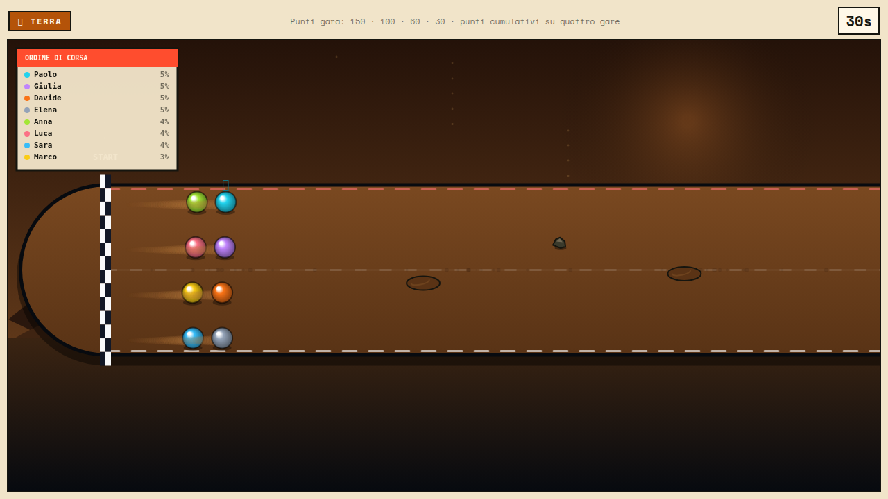
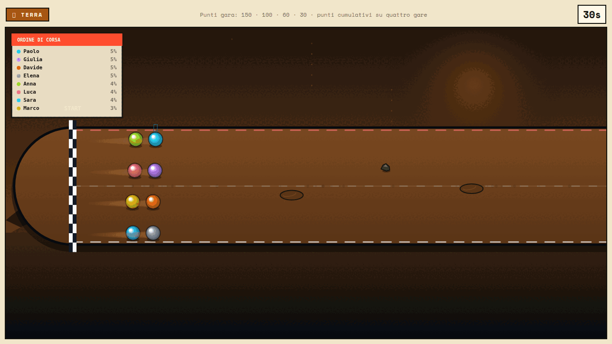
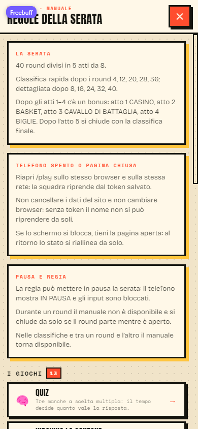
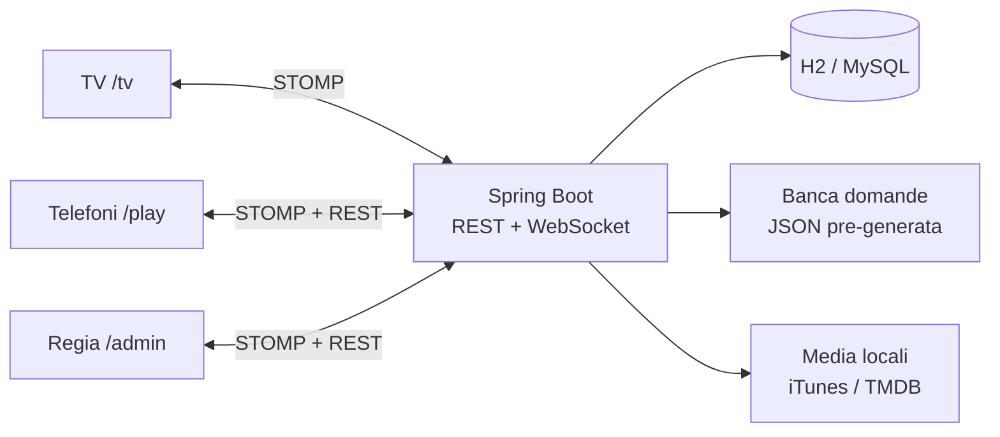

# PubGame

**La serata di quiz da pub, con la TV come tabellone e il telefono come pulsantiera.**
PubGame è un gioco multigiocatore per locali e feste: la TV mostra domande, tabelloni e classifiche, ogni squadra risponde dal proprio telefono e il presentatore conduce la serata da `/admin`. Frontend Angular e backend Spring Boot vivono in questo monorepo.







## 1. Cos'è

PubGame porta in sala un quiz a squadre in stile pub: nessuna app da installare, nessun account, un QR code sulla TV e il browser del telefono. La regia decide quando parte un round e quando si passa al successivo; il backend tiene sessioni, stato e recupero dopo un refresh.

La versione è **1.0.0**. Il codice è la fonte di verità: se una frase di questo README non combacia con il comportamento, vale il codice.

## 2. Come si gioca

- **TV (`/tv`)**: mostra il QR di ingresso, le domande, i tabelloni, i timer e le classifiche. È lo schermo condiviso.
- **Telefoni (`/play`)**: ogni squadra entra con un nickname e gioca dal browser. In attesa può aprire il **Manuale dei giochi**; durante un round il manuale si chiude e il pulsante sparisce.
- **Regia (`/admin`)**: il presentatore avvia e chiude i round, mette in pausa, mostra le classifiche, lancia i bonus e apre le demo. Non è un pannello di voto: le risposte arrivano dai telefoni.

La serata è una scaletta fissa di **40 round divisi in 5 atti da 8** (`shared/schedule.ts`). Dopo i round **4, 12, 20, 28 e 36** compare la classifica rapida; dopo **8, 16, 24, 32 e 40** quella dettagliata. Dopo gli atti 1–4 c'è un bonus: **Casino, Basket, Cavallo di battaglia, Biglie**. Dopo il quinto atto si chiude con la classifica finale.

Una serata completa dura indicativamente **3–4 ore**: è una stima, non un dato misurato, e dipende da quanto il presentatore allunga i tempi tra un round e l'altro. Il numero di telefoni consigliato è **4–10 squadre**; il codice non impone un limite rigido.

## 3. I giochi

I punteggi della tabella vengono da `apps/frontend/src/app/shared/models/scoring-rules.ts`; la scaletta e le occorrenze da `shared/schedule.ts`.

| Gioco | Tipo | Come funziona | Punti |
|---|---|---|---|
| **Quiz** | Sapere | Tre manche a scelta multipla; il tempo decide quanto vale una risposta. | Fino a **+1000** in 3 manches; errore = −quota della domanda; nessun malus se non si risponde. |
| **Indovina la canzone** | Sapere | Quattro ascolti da 30 secondi; ci si prenota e si sceglie titolo o artista. | **+1000** esatta, **−1000** sbagliata. |
| **Indovina chi** | Sapere | La foto si schiarisce con il tempo; ci si prenota e si risponde a voce. | **+1000 × tempo rimasto**; errore **−1000 × tempo rimasto**. |
| **Ruota della fortuna** | Sapere | Una frase a lettere coperte, timer lungo, prenotazione e risposta. | **+1000 × tempo rimasto**; errore **−1000 × tempo rimasto**. |
| **Timeline** | Sapere | Sei date da ordinare dal passato al presente, tutti sulla stessa scala. | Fino a **+1200** in base alle posizioni esatte su n; sotto **n/2 − 1** si perde, fino a **−400**. |
| **Time Buzzer** | Riflessi | Tre manche da 30 secondi per fermare il cronometro su un bersaglio di 5–29 secondi; i tagli eliminano progressivamente. | **+300 / +220 / +150 / +90 / +50** a fascia, manche dopo manche; tagliato **−250** o **−100**; finalisti **+150**. |
| **Bomba** | Rischio | Un tabellone, un turno per squadra; quasi tutte le caselle sono vere, una ogni tre squadre è falsa. | Casella vera: **0** e si passa il turno; falsa scelta: **−200** e fuori dal round; chi non risponde salta il turno. |
| **Speed Rush** | Riflessi | Sessanta secondi di risposte lampo; la corsia avanza a ogni risposta giusta. | **500** al primo, poi a scalare; minimo **100**; prendono punti solo i primi **n/2**. In serata reale è bloccato (vedi §10). |
| **Air Hockey Battle** | Riflessi | Duello a coppie: ogni risposta rapida rimanda il disco; il set si chiude a 7 gol. | **+1000** al vincitore, **+200** di consolazione al perdente; ogni gol subito è un gol per l'avversario. |
| **Azzardo** | Rischio | Quattro manche numeriche; dieci fiches da 20 punti da distribuire sulle quattro risposte. | Fiche giusta: **+20 × quota** (×2 facile, ×3 media, ×4 difficile); fiche sbagliate: **−20 × fiche × 100/80/60/40%**; mai sotto zero. |
| **Ultima spiaggia** | Rischio / sapere | Cinque livelli da 100 a 500, una volta per squadra in tutta la serata; una categoria per occorrenza. | **+100 / +200 / +300 / +400 / +500**; errore **−50 / −100 / −150 / −200 / −250**; chi non risponde perde metà del livello scelto. |
| **Blackjack** | Rischio | Tre mani contro il banco della TV: carta o stai. | **+250** a mano, **+500** con il naturale; sconfitta **−250** (mai sotto zero); sballare **−250**. |
| **Arena Battle Royale** | Sapere + riflessi | Battle royale a domande rapide dentro un cerchio che si chiude. | **+10 / −10** per risposta; piazzamento **+1000 / +500 / −300**. |

### I quattro bonus

| Bonus | Come funziona | Punti |
|---|---|---|
| **Casino** | Quattro manche di roulette: colore, dozzina, sestina e numero secco. | **+100 / +150 / +200 / +300** a manche; sullo zero il banco incassa. |
| **Basket** | Tre manche da 20 secondi con ferro largo, medio e piccolo. | **+2 / +3 / +5** a canestro, **+1** in più per lo swish. In serata reale è bloccato (vedi §10). |
| **Cavallo di battaglia** | Otto domande flash sulla categoria votata dai telefoni. | **+1** per risposta esatta. |
| **Biglie** | Quattro gare su fondi diversi, una biglia per tavolo scelta una volta sola. | **+150 / +100 / +60 / +30** a gara, punti cumulativi. |

**I bonus non assegnano ancora punti alla classifica della serata**: mostrano la classifica del bonus e si chiudono. È un limite noto, non una regola nascosta.

## 4. Tecnologie

| Area | Scelta | Perché |
|---|---|---|
| Frontend | **Angular 22.2** standalone, signal, router lazy, service worker PWA | Un'unica codebase per TV, telefono e regia; le signal rendono esplicito lo stato che arriva dalla socket. |
| Backend | **Spring Boot 4.1.2**, Java **25** | REST + WebSocket nello stesso processo, persistenza JPA e test di integrazione. |
| Realtime | **STOMP su WebSocket nativo** (`@stomp/stompjs`) | Una sola socket per dispositivo, senza il fallback XHR di SockJS; riconnessione con backoff e jitter. L'endpoint SockJS resta disponibile sul backend, ma il frontend usa il WebSocket nativo. |
| Dati | **H2** su file in locale, profilo **MySQL** per il servizio | Zero installazioni per la serata; MySQL quando serve un database gestito. |
| Fisica | **Matter.js** per roulette e Biglie; fisica dedicata per il Basket | La roulette e le biglie sono corpi rigidi; il tiro a canestro ha una simulazione sua. |
| Qualità | **Vitest 5.1 + jsdom** e **JUnit / Spring Boot Test** | Test veloci sul frontend e test di integrazione sul backend. |
| Consegna | **Docker** fullstack | Un solo container serve TV, telefoni, API e WebSocket. |

## 5. Architettura



**Chi possiede lo stato.** Il backend è l'autorità su sessioni, stato della partita, round, punteggi verificati (Arena, Timeline, Bomba, Blackjack, validazione delle fiches dell'Azzardo) e prova dei pulsanti. La TV possiede la presentazione e la maggior parte dello stato di gioco della singola modalità; i telefoni possiedono input e timer locali. Questa divisione è il motivo per cui alcune modalità hanno ancora tempi dichiarati dal client: è un limite noto, non un dettaglio da nascondere.

**Sessioni, sincronizzazione e ripresa.** Ogni dispositivo apre una sessione con `POST /games/{id}/session` e riceve un token; il token viene salvato per ruolo (`TV`, `ADMIN`, `REMOTE`) e usato su REST e STOMP. Dopo una riconnessione il client chiede `/sync` e riceve snapshot + eventi mancanti. La TV e la regia possono riprendere la stessa serata da un altro dispositivo con lo stesso segreto; un telefono riprende la propria squadra finché conserva il token.

**Sicurezza.** `CONTROL_SECRET` (almeno 32 caratteri) protegge l'apertura delle sessioni TV/admin; `ALLOWED_ORIGINS` limita le origini esatte di REST e WebSocket. Non ci sono cookie di sessione: l'autenticazione viaggia in header. I punteggi critici vengono calcolati o validati dal server. Restano aperti i limiti elencati in §10.

## 6. Avvio rapido

### Docker (consigliato per la serata)

```bash
cp deploy/.env.test.example deploy/.env
# apri deploy/.env e imposta CONTROL_SECRET (almeno 32 caratteri casuali)
docker compose -f deploy/docker-compose.test.yml --env-file deploy/.env up -d --build
```

Poi apri `http://localhost:8080/tv` sul PC e inquadra il QR con i telefoni. La regia è su `http://localhost:8080/admin`. Il test compose usa `ALLOWED_ORIGINS=*` perché è pensato per una rete locale di prova; non usarlo così in produzione.

### Sviluppo con npm

Servono **Node.js 22.22+** (o 24.15+), **npm 11** e **JDK 25**.

```bash
npm install
cp .env.example .env
# imposta CONTROL_SECRET e, se apri dai telefoni, ALLOWED_ORIGINS
npm run dev
```

La guida passo-passo per computer, TV, telefoni, Docker, LAN e problemi frequenti è in **[`docs/SETUP-LOCALE.md`](docs/SETUP-LOCALE.md)**. Per tunnel, dominio, Vercel, PWA e backup la guida è **[`docs/DEPLOYMENT.md`](docs/DEPLOYMENT.md)**; per il container unico c'è **[`deploy/README.md`](deploy/README.md)**. Questo README non li duplica.

## 7. Struttura delle cartelle

```text
apps/
├── frontend/src/app/
│   ├── core/          environment, WebSocket, servizi condivisi, guardie
│   ├── features/      tv/, remote/, admin/, games/, bonus/
│   └── shared/        modelli, enum, schedule, manuale, doppi di test
└── backend/src/main/java/com/pub_game_be/
    ├── config/        sicurezza, WebSocket, forward SPA
    ├── controller/    REST e STOMP
    ├── domain/        entità e enum
    ├── dto/           payload
    ├── reliability/   sessioni, stato, sync, prova pulsanti
    ├── repository/    JPA
    ├── security/      filtro sessioni e CORS
    └── service/       logica di gioco e domande
scripts/               avvio unificato, wrapper Maven, generazione contenuti
docs/                  setup, deployment, screenshot
deploy/                compose, Caddy, variabili di esempio
```

## 8. Come aggiungere un gioco

1. Aggiungi il valore all'enum condiviso `GameModeType` e inseriscilo nella scaletta in `shared/schedule.ts` (la scaletta è l'unica fonte di verità per round e occorrenze).
2. Crea la modalità in `features/games/<gioco>/` con il suo componente TV e, se serve, lo stato di gioco.
3. Aggiungi la schermata del telefono in `features/remote` e i relativi eventi STOMP; usa gli enum condivisi, non stringhe nuove.
4. Aggiungi i punteggi in `shared/models/scoring-rules.ts`: la tabella è letta da admin, manuale e demo.
5. Aggiungi la demo in `features/tv/demo-scripts.ts`: il test di copertura fallisce se una modalità della scaletta non ha demo o se un numero non coincide.
6. Aggiungi la descrizione del manuale in `shared/manual/manual-content.ts` e verifica che il testo resti generato dalle regole.
7. Scrivi i test della modalità, aggiorna quelli di copertura e lancia `npm run test:frontend` e `npm run build:frontend`.

## 9. Test e qualità

```bash
npm run test:frontend    # Vitest + jsdom
npm run test:backend     # JUnit / Spring Boot Test
npm run build:frontend   # ng build
npm run build:backend    # Maven package
```

Il frontend ha **28 file di spec**; il backend **11 classi di test**. Le verifiche coprono, tra l'altro: regole di punteggio e scaletta, contenuti del manuale, copertura delle demo, round manager, apertura/chiusura del manuale sul telefono, modalità TV, sessioni e riconnessione, prova dei pulsanti, API e servizi del backend.

**Limiti noti dei test**: non esiste ancora una prova end-to-end multi-dispositivo in rete; i controlli visivi sono manuali (TV e telefono); i timer dichiarati dal client non sono interamente verificabili dal server.

## 10. Stato e roadmap

**Pronto**

- Scaletta completa di 40 round in 5 atti, 13 modalità e 4 bonus.
- Ingresso con QR, squadre con token, ripresa dopo refresh o cambio dispositivo.
- Manuale dei giochi sul telefono, con apertura consentita solo fuori dal round.
- Sezione Demo nell'admin: 18 voci (introduzione + 13 giochi + 4 bonus), cinque scene per voce e tabella punti generata da `SCORING_RULES`.
- Classifiche rapide e dettagliate, pausa, ripresa, diagnostica di regia.
- Banca domande pre-generata: 991 domande, 360 domande Azzardo, 113 eventi Timeline.

**Limitato o bloccato**

- **Speed Rush**: in serata reale `startNewRound()` mostra un avviso e non avvia il gioco, perché il punteggio non è ancora verificato dal server. È disponibile solo in simulazione (`?sim=1`). La scaletta si ferma quando incontra il round 18.
- **Bonus Basket**: è bloccato fuori da simulazione e anteprima; il tabellone si può vedere in demo. Il punteggio non è ancora verificato dal server.
- **Bonus e classifica**: i bonus mostrano una classifica propria ma non aggiungono punti alla classifica della serata.
- **Tempi dichiarati dal client**: alcune modalità usano tempi o stato del telefono; i punteggi non sono tutti verificabili lato server.
- **Sicurezza**: mancano rate limiting e recupero assistito del nome; un partecipante può prenotare per primo il nickname di un'altra squadra. Le sessioni non vengono revocate cambiando `CONTROL_SECRET`.
- **Rete**: manca una prova multi-dispositivo in rete e una suite E2E nel repository.

**In programma**

- Verifica server-side di Speed Rush e Basket, con percorso di avanzamento completo.
- Punti dei bonus nella classifica della serata.
- Rate limiting sulle sessioni e recupero assistito dei nomi.
- Test end-to-end con più browser e dispositivi reali.

## 11. Contenuti e licenze

- **Domande**: `apps/backend/src/main/resources/questions/questions-it.json` (991 domande, 17 categorie, inclusa Air Hockey), `azzardo-it.json` (360) e `timeline-it.json` (113 eventi). Il backend le carica all'avvio e non chiama alcun modello AI a runtime.
- **Generazione**: `scripts/generate-questions/generate.py` può usare Groq, ma solo quando si rigenera la banca. `GROQ_API_KEY` non serve per giocare.
- **Immagini**: “Indovina chi” può usare TMDB se `TMDB_API_KEY` è impostata; senza chiave la domanda resta senza foto. Con la banca media locale le immagini vengono servite dal backend.
- **Musica**: senza banca locale il backend usa le anteprime pubbliche di 30 secondi dell'iTunes Search API.
- **Come aggiungere domande**: aggiungi voci alla banca JSON (o rigenera con lo script) mantenendo ID univoci e categorie esistenti; riavvia il backend e verifica la diagnostica delle domande usate.
- **Licenze**: nel repository non c'è un file `LICENSE`. I testi delle domande e il codice appartengono al proprietario del repository; le foto TMDB e le anteprime iTunes restano soggette ai rispettivi termini. Prima di un uso pubblico o commerciale verifica le licenze delle fonti multimediali.

## 12. Licenza e contatti

Nessun file di licenza è incluso: l'uso è riservato al proprietario del repository, salvo accordi diversi.

Repository: [github.com/psiep8/pub_game_FE](https://github.com/psiep8/pub_game_FE)

Per segnalazioni o proposte: apri una issue nel repository.
