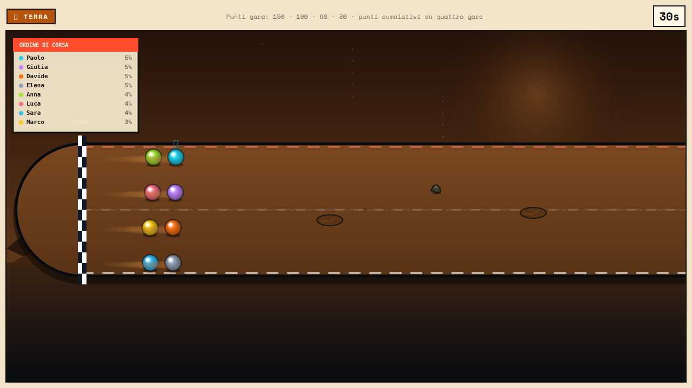
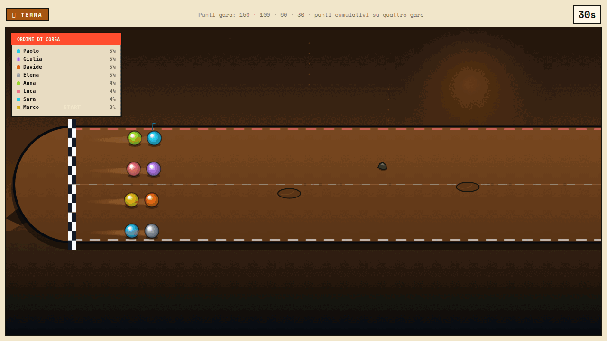
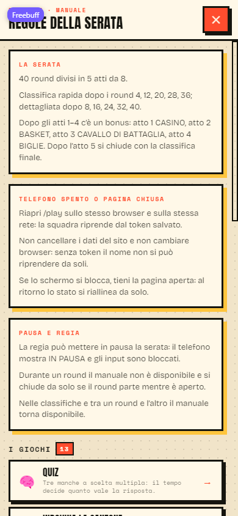
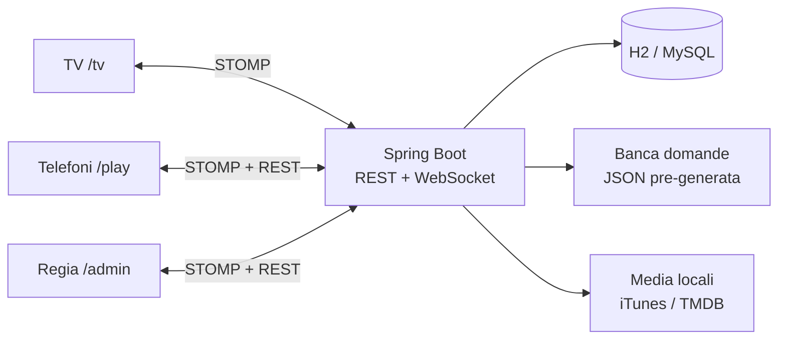

# PubGame

**La serata di quiz da pub, con la TV come tabellone e il telefono come pulsantiera.**
PubGame è un gioco multigiocatore per locali e feste: la TV mostra domande, tabelloni e classifiche, ogni squadra risponde dal proprio telefono e il presentatore conduce la serata da `/admin`. Frontend Angular e backend Spring Boot vivono in questo monorepo.







> **Indice:** [Cos'è](#1-cosè) · [Come si gioca](#2-come-si-gioca) · [I giochi](#3-i-giochi) · [Tecnologie](#4-tecnologie) · [Architettura](#5-architettura) · [Avvio rapido](#6-avvio-rapido) · [Cartelle](#7-struttura-delle-cartelle) · [Aggiungere un gioco](#8-come-aggiungere-un-gioco) · [Test](#9-test-e-qualità) · [Audio](#10-audio) · [Serata di prova](#11-serata-di-prova) · [Stato e roadmap](#12-stato-e-roadmap) · [Contenuti e licenze](#13-contenuti-e-licenze) · [Licenza e contatti](#14-licenza-e-contatti) · [Documentazione](#15-mappa-della-documentazione)

## 1. Cos'è

PubGame porta in sala un quiz a squadre in stile pub: nessuna app da installare, nessun account, un QR code sulla TV e il browser del telefono. La regia decide quando parte un round e quando si passa al successivo; il backend tiene sessioni, stato e recupero dopo un refresh.

La versione è **2.1.0**. Il codice è la fonte di verità: se una frase di questo README non combacia con il comportamento, vale il codice.

## 2. Come si gioca

- **TV (`/tv`)**: mostra il QR di ingresso, le domande, i tabelloni, i timer e le classifiche. È lo schermo condiviso.
- **Telefoni (`/play`)**: ogni squadra entra con un nickname e gioca dal browser. In attesa può aprire il **Manuale dei giochi**; durante un round il manuale si chiude e il pulsante sparisce.
- **Regia (`/admin`)**: il presentatore avvia e chiude i round, mette in pausa, mostra le classifiche, lancia i bonus e apre le demo. Non è un pannello di voto: le risposte arrivano dai telefoni.

La serata è una scaletta fissa di **40 round divisi in 5 atti da 8** (`shared/schedule.ts`). Dopo i round **4, 12, 20, 28 e 36** compare la classifica rapida; dopo **8, 16, 24, 32 e 40** quella dettagliata. Le **Biglie sono quattro round separati** (11, 22, 28, 37), ognuno con due gare su due delle otto piste (rally, F1, neve, acqua, vetro, sabbia, spazio, magma); il **Blackjack non è più in scaletta** e resta solo come bonus. Dopo **ognuno** dei cinque atti parte un bonus diverso: Casino bianco/rosso, Blackjack, Casino dozzina, Cavallo e Casino numero secco. I punti del bonus entrano in classifica alla chiusura; dopo l'ultimo si chiude con la classifica finale.

Una serata completa dura indicativamente **3–4 ore**: è una stima, non un dato misurato, e dipende da quanto il presentatore allunga i tempi tra un round e l'altro. Il numero di telefoni consigliato è **4–10 squadre**; il codice non impone un limite rigido.

## 3. I giochi

I punteggi della tabella vengono da `apps/frontend/src/app/shared/models/scoring-rules.ts`; la scaletta e le occorrenze da `shared/schedule.ts`.

| Gioco | Tipo | Come funziona | Punti |
|---|---|---|---|
| **Quiz** | Sapere | Tre manche a scelta multipla; il tempo decide quanto vale una risposta. | Fino a **+1000** in 3 manches; errore = −quota della domanda; nessun malus se non si risponde. |
| **Indovina la canzone** | Sapere | Quattro ascolti da 30 secondi; ci si prenota e si sceglie titolo o artista. | **+1000 × secondi rimasti** (minimo **+250**), **−1000** sbagliata. |
| **Indovina chi** | Sapere | La foto si schiarisce con il tempo; ci si prenota e si risponde a voce. | **+1000 × tempo rimasto**; errore **−1000 × tempo rimasto**. |
| **Ruota della fortuna** | Sapere | Una frase a lettere coperte, timer lungo, prenotazione e risposta. | **+1000 × tempo rimasto**; errore **−1000 × tempo rimasto**. |
| **Timeline** | Sapere | Sei date da ordinare dal passato al presente, tutti sulla stessa scala. | Fino a **+1200** in base alle posizioni esatte su n; sotto **n/2 − 1** si perde, fino a **−400**. |
| **Time Buzzer** | Riflessi | Tre manche da 30 secondi per fermare il cronometro su un bersaglio di 5–20 secondi; i tagli eliminano progressivamente. | **+300 / +220 / +150 / +90 / +50** a fascia, manche dopo manche; tagliato **−250** o **−100**; finalisti **+150**. |
| **Bomba** | Rischio | Un tabellone, un turno per squadra; quasi tutte le caselle sono vere, una ogni tre squadre è falsa. | Casella vera: **0** e si passa il turno; falsa scelta: **−200** e fuori dal round; chi non sceglie in tempo è **eliminato** (**−200**) e salta le ondate successive. Durante l'ondata le caselle restano coperte: bombe, eliminati e penalità si scoprono solo alla fine. |
| **Speed Rush** | Riflessi | 90 secondi di risposte lampo; la corsia avanza a ogni risposta giusta. | **500** al primo, poi a scalare; minimo **100**; prendono punti solo i primi **n/2**. Progressi, arrivi e punti arrivano dal server; le prove non si ripetono e salgono di difficoltà. |
| **Tennis Battle** | Riflessi | Duello a coppie: ogni risposta rimanda la palla; punteggio da tennis (15, 30, 40, vantaggio) e killer point dopo tre ritorni dal vantaggio. Le domande salgono da facili a difficili e il disco arriva dritto, a zig-zag, a giro o a salto. | **+1000** al vincitore, **+200** di consolazione al perdente; ogni gol subito è un gol per l'avversario. |
| **Biglie** | Fortuna / spettacolo | Corsa di biglie su una pista con curve e ostacoli, disegnata e simulata dalla TV con la stessa geometria. Ogni tavolo sceglie una biglia una sola volta e la porta nelle due gare del round; non si gioca dal telefono durante la corsa. | **+150 / +100 / +60 / +30** a gara (primi quattro); chi arriva dopo prende **0**. |
| **Azzardo** | Rischio | Quattro manche numeriche; dieci fiches da 20 punti da distribuire sulle quattro risposte. | Fiche giusta: **+20 × quota** (×2 facile, ×3 media, ×4 difficile); fiche sbagliate: **−20 × fiche × 100/80/60/40%**; mai sotto zero. La puntata parte solo con **CONFERMA PUNTATA** e almeno una fiche; le fiches avanzate si sommano alle dieci nuove e alzano il tetto di una fiche ogni due risparmiate (max **15**, quindi al massimo **+1000** in una manche). |
| **Ultima spiaggia** | Rischio / sapere | Cinque livelli da 100 a 500, una volta per squadra in tutta la serata; una categoria per occorrenza. | **+100 / +200 / +300 / +400 / +500**; errore **−50 / −100 / −150 / −200 / −250**; chi non risponde perde metà del livello scelto. |
| **Arena Battle Royale** | Sapere + riflessi | Battle royale a domande rapide dentro un cerchio che si chiude. | **+10 / −10** per risposta; piazzamento **+1000 / +500 / −300**. |

### I bonus della serata

| Bonus | Dopo | Come funziona | Punti |
|---|---|---|---|
| **Casino bianco/rosso** | atto 1 | Una sola manche sul colore; la ruota europea gira una volta. | Colore giusto **+100**; zero: banco. |
| **Blackjack** | atto 2 | Un turno per tavolo, 15 s, carta o stai; il banco si ferma a 17. | Vittoria **+150**, pari **+75**, sconfitta **0**. |
| **Casino dozzina** | atto 3 | Una sola manche su 1–12, 13–24 o 25–36. | Dozzina giusta **+120**. |
| **Cavallo di battaglia** | atto 4 | Categoria votata dai telefoni, otto domande flash. | Podio **+200 / +100 / +50**. |
| **Casino numero secco** | atto 5 | Una puntata su un numero da 0 a 36; la ruota rigira finché qualcuno lo ha puntato. | Numero esatto **+300**. |

**I punti dei bonus entrano nella classifica della serata una sola volta, alla chiusura del bonus.** Dopo il bonus dell’atto 5 la TV mostra la classifica finale aggiornata.

## 4. Tecnologie

| Area | Scelta | Perché |
|---|---|---|
| Frontend | **Angular 22.2** standalone, signal, router lazy, service worker PWA | Un'unica codebase per TV, telefono e regia; le signal rendono esplicito lo stato che arriva dalla socket. |
| Backend | **Spring Boot 4.1.2**, Java **25** | REST + WebSocket nello stesso processo, persistenza JPA e test di integrazione. |
| Realtime | **STOMP su WebSocket nativo** (`@stomp/stompjs`) | Una sola socket per dispositivo, senza il fallback XHR di SockJS; riconnessione con backoff e jitter. L'endpoint SockJS resta disponibile sul backend, ma il frontend usa il WebSocket nativo. |
| Dati | **H2** su file in locale, profilo **MySQL** per il servizio | Zero installazioni per la serata; MySQL quando serve un database gestito. |
| Fisica | **Matter.js** per roulette e Biglie | La roulette e le biglie sono corpi rigidi con collisioni reali; disegno e muri usano la stessa geometria. |
| Qualità | **Vitest 5.1 + jsdom** e **JUnit / Spring Boot Test** | Test veloci sul frontend e test di integrazione sul backend. |
| Consegna | **Docker** fullstack | Un solo container serve TV, telefoni, API e WebSocket. |

## 5. Architettura



**Chi possiede lo stato.** Il backend è l'autorità su sessioni, stato della partita, round, punteggi verificati (Arena, Timeline, Bomba, Blackjack, validazione delle fiches dell'Azzardo) e prova dei pulsanti. La TV possiede la presentazione e la maggior parte dello stato di gioco della singola modalità; i telefoni possiedono input e timer locali. Questa divisione è il motivo per cui alcune modalità hanno ancora tempi dichiarati dal client: è un limite noto, non un dettaglio da nascondere.

**Sessioni, sincronizzazione e ripresa.** Ogni dispositivo apre una sessione con `POST /games/{id}/session` e riceve un token; il token viene salvato per ruolo (`TV`, `ADMIN`, `REMOTE`) e usato su REST e STOMP. Dopo una riconnessione il client chiede `/sync` e riceve snapshot + eventi mancanti. La TV e la regia possono riprendere la stessa serata da un altro dispositivo con lo stesso segreto; un telefono riprende la propria squadra finché conserva il token.

**Sicurezza.** `CONTROL_SECRET` (almeno 32 caratteri) protegge l'apertura delle sessioni TV/admin; `ALLOWED_ORIGINS` limita le origini esatte di REST e WebSocket. Non ci sono cookie di sessione: l'autenticazione viaggia in header. I punteggi critici vengono calcolati o validati dal server. Restano aperti i limiti elencati in [§12](#12-stato-e-roadmap).

## 6. Avvio rapido

### Docker (consigliato per la serata)

```bash
cp deploy/.env.test.example deploy/.env
# apri deploy/.env e imposta CONTROL_SECRET (almeno 32 caratteri casuali)
docker compose -f deploy/docker-compose.test.yml --env-file deploy/.env up -d --build
```

Poi apri `http://localhost:8080/tv` sul PC e inquadra il QR con i telefoni. La regia è su `http://localhost:8080/admin`. Il test compose usa `ALLOWED_ORIGINS=*` perché è pensato per una rete locale di prova; non usarlo così in produzione.

### Sviluppo con npm

Servono **Node.js 22.22+** (o 24.15+), **npm 11** e **JDK 25**.

```bash
npm install
cp .env.example .env
# imposta CONTROL_SECRET e, se apri dai telefoni, ALLOWED_ORIGINS
npm run dev
```

La guida passo-passo per computer, TV, telefoni, Docker, LAN e problemi frequenti è in **[`docs/SETUP-LOCALE.md`](docs/SETUP-LOCALE.md)**. Per tunnel, dominio, Vercel, PWA e backup la guida è **[`docs/DEPLOYMENT.md`](docs/DEPLOYMENT.md)**; per il container unico c'è **[`deploy/README.md`](deploy/README.md)**. Questo README non li duplica.

Per chi conduce la serata la guida operativa è **[`docs/PRESENTATORE.md`](docs/PRESENTATORE.md)** (schermi, pulsanti, decisioni, imprevisti); il copione con le frasi da dire resta **[`PRESENTAZIONE-PUBGAME.md`](PRESENTAZIONE-PUBGAME.md)**. I pulsanti del pannello sono in **[`docs/PANNELLO-ADMIN.md`](docs/PANNELLO-ADMIN.md)**, il telefono delle squadre in **[`docs/MANUALE-TELEFONO.md`](docs/MANUALE-TELEFONO.md)**.

## 7. Struttura delle cartelle

```text
apps/
├── frontend/src/app/
│   ├── core/          environment, WebSocket, servizi condivisi, guardie
│   ├── features/      tv/, remote/, admin/, games/, bonus/
│   └── shared/        modelli, enum, schedule, manuale, doppi di test
└── backend/src/main/java/com/pub_game_be/
    ├── config/        sicurezza, WebSocket, forward SPA
    ├── controller/    REST e STOMP
    ├── domain/        entità e enum
    ├── dto/           payload
    ├── reliability/   sessioni, stato, sync, prova pulsanti
    ├── repository/    JPA
    ├── security/      filtro sessioni e CORS
    └── service/       logica di gioco e domande
scripts/               avvio unificato, wrapper Maven, generazione contenuti
docs/                  setup, deployment, screenshot
deploy/                compose, Caddy, variabili di esempio
```

## 8. Come aggiungere un gioco

1. Aggiungi il valore all'enum condiviso `GameModeType` e inseriscilo nella scaletta in `shared/schedule.ts` (la scaletta è l'unica fonte di verità per round e occorrenze).
2. Crea la modalità in `features/games/<gioco>/` con il suo componente TV e, se serve, lo stato di gioco.
3. Aggiungi la schermata del telefono in `features/remote` e i relativi eventi STOMP; usa gli enum condivisi, non stringhe nuove.
4. Aggiungi i punteggi in `shared/models/scoring-rules.ts`: la tabella è letta da admin, manuale e demo.
5. Aggiungi la demo in `features/tv/demo-scripts.ts`: il test di copertura fallisce se una modalità della scaletta non ha demo o se un numero non coincide.
6. Aggiungi la descrizione del manuale in `shared/manual/manual-content.ts` e verifica che il testo resti generato dalle regole.
7. Scrivi i test della modalità, aggiorna quelli di copertura e lancia `npm run test:frontend` e `npm run build:frontend`.

## 9. Test e qualità

```bash
npm run test:frontend    # Vitest + jsdom
npm run test:backend     # JUnit / Spring Boot Test
npm run build:frontend   # ng build
npm run build:backend    # Maven package
```

Il frontend ha **64 file di spec (539 test al 19 novembre 2026)**; il backend **30 file di test**. Le verifiche coprono, tra l'altro: regole di punteggio e scaletta, contenuti del manuale, copertura delle demo, round manager, apertura/chiusura del manuale sul telefono, modalità TV, sessioni e riconnessione, prova dei pulsanti, API e servizi del backend.

**Limiti noti dei test**: la suite frontend deve compilare per intero (un solo errore TypeScript in una spec ferma tutti i test);  non esiste ancora una prova end-to-end multi-dispositivo in rete; i controlli visivi sono manuali (TV e telefono); i timer dichiarati dal client non sono interamente verificabili dal server.

## 10. Audio

La colonna sonora della TV suona **file registrati** in `apps/frontend/public/assets/audio` (41 effetti e 7 loop in AAC `.m4a`, ~12 MB). Fonte e licenza di ogni file stanno in `FONTI.txt` e in `docs/CREDITI-AUDIO.md`. Nel codice non c'è più sintesi di eventi (Foley e i tappeti generati sono stati rimossi): resta solo la coda di stanza in `audio-dsp.ts`. Se un file manca, non suona nulla e compare un avviso in console.

- **Sottofondi.** Piano a **20 loop**: una base per ciascun atto (5, tutte diverse) più un loop per i giochi e i bonus che ne reggono uno. **Oggi sono in cartella 7 su 20**; gli altri 13 sono da consegnare e, finché mancano, il gioco suona il loop più vicino o la base d'atto. La mappa gioco → loop è in `core/services/bed-map.ts`, il registro dei file in `bed-loops.ts`; il documento di riferimento è [`docs/SOTTOFONDI.md`](docs/SOTTOFONDI.md).
- **Regola di riproduzione.** La base d'atto suona di default; il loop del gioco la sostituisce con una dissolvenza di 1,5 s e a fine gioco si torna alla base. Musica e Time Buzzer restano in silenzio; durante la domanda di Quiz e Indovina chi la musica scende di 6 dB. I loop si caricano con l'atto e il service worker li tiene in cache.
- **Effetti e segnali.** Battito (dal round 20 cresce con la serata), tick del clock, suspense nei giochi a countdown, reveal, fanfara e podio. Mute con dissolvenza; la pausa ferma clock e battito.
- **Regia audio.** La pagina `/audio` permette di ascoltare ogni evento, i sottofondi per atto e per gioco e il loro peso.
- **Manifesto e script.** `docs/MANIFESTO-AUDIO.md` è la fonte dei nomi dei file; `node scripts/audio/process-audio.mjs` normalizza (effetti −16 LUFS, loop −23 LUFS), taglia e converte i file grezzi messi in `_src/`.

Prima di una serata si ascolta la sala a volume vero: la checklist è in `docs/SERATA-PROVA.md` §3.3.

## 11. Serata di prova

Prima di una serata con telefoni veri:

1. `cp .env.test-night.example .env` e compila `CONTROL_SECRET` (≥ 32 caratteri) e `ALLOWED_ORIGINS` con IP LAN del PC.
2. `npm run db:backup` (copia in `backups/`, fuori dal repository).
3. `npm run dev`, poi `curl http://localhost:8080/health` deve rispondere `{"status":"ok"}`.
   Con Docker: `PUBGAME_TAG=2.1.0 docker compose up -d` fissa la versione, così un
   aggiornamento sbagliato si annulla cambiando tag.
4. Giro a vuoto con un iPhone e un Android: ingresso, un round, refresh della TV, blocco schermo di 60 secondi.

Il programma completo (ruoli, tempi, prove di caduta, cosa annotare, emergenze) è in **`docs/SERATA-PROVA.md`**. L'ordine delle fix da chiudere prima e dopo la serata è in **`docs/FIX-PRE-SERATA.md`**.

## 12. Stato e roadmap

Il registro completo dei difetti emersi nella prima serata (F01–F55), con stato e prova di ciascuno, è in [`docs/ROADMAP-POST-PRIMA-SERATA.md`](docs/ROADMAP-POST-PRIMA-SERATA.md). Una voce «corretta nel codice» significa verificata con test, **non** provata in sala.

**Pronto**

- Scaletta di 40 round in 5 atti, 13 modalità e 5 bonus a fine atto.
- Ingresso con QR, squadre con token, ripresa dopo refresh o cambio dispositivo; la TV e la regia riprendono la maggior parte dei giochi e dei bonus dopo un refresh (matrice in `docs/ROADMAP-POST-PRIMA-SERATA.md`).
- Manuale dei giochi sul telefono, apribile solo fuori dai round.
- Sezione Demo nell'admin (introduzione, 13 giochi, 5 bonus) con tabella punti generata da `SCORING_RULES`.
- Classifiche rapide e dettagliate, pausa, ripresa, diagnostica di regia, espulsione di una squadra dalla regia.
- Audio a file registrati con regia audio in `/audio`.
- Banca domande pre-generata: 991 domande, 360 domande Azzardo, 113 eventi Timeline.

**Da provare con telefoni e TV veri** (corrette nel codice, non verificate in sala): rientro su iPhone e Safari, Time Buzzer, Arena (cerchio, movimento, inattività), Speed Rush a 90 secondi, Tennis dopo la migrazione del database, Bomba con esplosione immediata, vibrazione e suono sui telefoni.

**Limitato o aperto**

- **Sottofondi:** 13 loop su 20 ancora da consegnare.
- **Font:** i caratteri (Anton, Space Mono, Bricolage Grotesque) sono serviti dal repository in `apps/frontend/public/assets/fonts`, quindi la serata regge anche senza internet.
- **Tempi dichiarati dal client:** alcune modalità usano tempi o stato del telefono; i punteggi non sono tutti verificabili lato server.
- **Sicurezza:** mancano rate limiting e recupero assistito del nome; un partecipante può prenotare per primo il nickname di un'altra squadra. Le sessioni non vengono revocate cambiando `CONTROL_SECRET`.
- **Rete:** manca una prova multi-dispositivo in rete e una suite E2E nel repository.
- **Cavallo di battaglia:** non ha funzionato nella prima serata e va riprovato in sala.

**In programma**

- Consegna dei 13 sottofondi mancanti.
- Minigiochi lampo a sorpresa fra un round e l'altro (idea documentata, **non ancora implementata**).
- Rate limiting sulle sessioni e recupero assistito dei nomi.
- Test end-to-end con più browser e dispositivi reali.

## 13. Contenuti e licenze

- **Domande**: `apps/backend/src/main/resources/questions/questions-it.json` (991 domande, 16 categorie; Tennis Battle è un tipo di domanda, non una categoria), `azzardo-it.json` (360) e `timeline-it.json` (113 eventi). Il backend le carica all'avvio e non chiama alcun modello AI a runtime.
- **Generazione**: `scripts/generate-questions/generate.py` può usare Groq, ma solo quando si rigenera la banca. `GROQ_API_KEY` non serve per giocare.
- **Immagini**: “Indovina chi” può usare TMDB se `TMDB_API_KEY` è impostata; senza chiave la domanda resta senza foto. Se la banca media locale è presente, le immagini vengono servite dal backend.
- **Musica**: senza banca locale il backend usa le anteprime pubbliche di 30 secondi dell'iTunes Search API; con la banca locale i file sono serviti da `/media/...`.
- **Banca media locale (opzionale)**: può contenere anche i volti (`static/media/people/*.jpg`), le copertine (`static/media/covers/*.jpg`) e i brani (`static/media/music/*.m4a`), indicizzati da `questions/media-it.json`. **Non è inclusa nel repository**: `.gitignore` esclude `static/media/` e `media-it.json`. Va generata con `python scripts/generate-questions/generate_media.py --from-azzardo` (o copiata) prima della build. Con la banca installata il backend non chiama iTunes, TMDB o Wikipedia: ciò che manca resta un segnaposto.
- **Come aggiungere domande**: aggiungi voci alla banca JSON (o rigenera con lo script) mantenendo ID univoci e categorie esistenti; riavvia il backend e verifica la diagnostica delle domande usate.
- **Licenze**: nel repository non c'è un file `LICENSE`. I testi delle domande e il codice appartengono al proprietario del repository; le foto TMDB e le anteprime iTunes restano soggette ai rispettivi termini. Prima di un uso pubblico o commerciale verifica le licenze delle fonti multimediali.

## 14. Licenza e contatti

Nessun file di licenza è incluso: l'uso è riservato al proprietario del repository, salvo accordi diversi.

Repository: [github.com/psiep8/pub_game_FE](https://github.com/psiep8/pub_game_FE)

Per segnalazioni o proposte: apri una issue nel repository.

## 15. Mappa della documentazione

| Documento | A cosa serve |
|---|---|
| [`docs/SETUP-LOCALE.md`](docs/SETUP-LOCALE.md) | Installare e far girare il gioco su un computer, TV e telefoni |
| [`docs/DEPLOYMENT.md`](docs/DEPLOYMENT.md), [`deploy/README.md`](deploy/README.md) | Tunnel, dominio, container unico, backup |
| [`docs/PRESENTATORE.md`](docs/PRESENTATORE.md), [`docs/PANNELLO-ADMIN.md`](docs/PANNELLO-ADMIN.md), [`docs/AVVIO-SERATA-ADMIN.md`](docs/AVVIO-SERATA-ADMIN.md) | Condurre la serata dalla regia |
| [`docs/MANUALE-TELEFONO.md`](docs/MANUALE-TELEFONO.md), [`docs/manuale-serata.pdf`](docs/manuale-serata.pdf) | Guida per le squadre |
| [`docs/SERATA-PROVA.md`](docs/SERATA-PROVA.md) | Programma e checklist della prova con telefoni veri |
| [`docs/ROADMAP-POST-PRIMA-SERATA.md`](docs/ROADMAP-POST-PRIMA-SERATA.md), [`docs/FIX-PRE-SERATA.md`](docs/FIX-PRE-SERATA.md) | Registro dei difetti e stato delle correzioni |
| [`docs/SOTTOFONDI.md`](docs/SOTTOFONDI.md), [`docs/MANIFESTO-AUDIO.md`](docs/MANIFESTO-AUDIO.md), [`docs/AUDIO-CATALOGO.md`](docs/AUDIO-CATALOGO.md), [`docs/CREDITI-AUDIO.md`](docs/CREDITI-AUDIO.md) | Audio: loop, file, catalogo, crediti |
| [`DESCRIZIONE-GIOCO.md`](DESCRIZIONE-GIOCO.md), [`PRESENTAZIONE-PUBGAME.md`](PRESENTAZIONE-PUBGAME.md) | Descrizione e copione di presentazione |
| [`AGENTS.md`](AGENTS.md) | Stile grafico obbligatorio e regole per chi modifica l'interfaccia |
| [`CHANGELOG.md`](CHANGELOG.md) | Storia delle modifiche |
